# 🍞 gestion-panaderiakiataque-vue

Este repositorio contiene la plataforma web desarrollada con **Vue 3** y **Vite** diseñada para digitalizar y optimizar la gestión operativa de la **Panadería Kiataque**, junto con las pruebas del servicio API RESTful en **.NET 7 Web API**.

---

## 👥 Integrantes

| Integrante | Rol / Responsabilidad | GitHub |
| :--- | :--- | :--- |
| **Anderson Carvajal Romero** | Diseño de Interfaces & Frontend | [AndersonCarvajal](https://github.com/AndersonCarvajal) |
| **Marco Antonio Kiataque Uchima** | Diseño de Interfaces & Frontend | [MarcoKiataque27](https://github.com/MarcoKiataque27) |
| **Luis Gerardo Portillo Gonzales** | Diseño de Interfaces & Frontend | [Mauroc95666](https://github.com/Mauroc95666) |

---

## 📑 Tabla de Contenidos

1. [Descripción del Proyecto](#-descripción-del-proyecto)
2. [Diseño de Interfaces](#-diseño-de-interfaces)
   - [Anderson Carvajal Romero (Pantallas 1 y 2)](#-anderson-carvajal-romero)
   - [Marco Antonio Kiataque Uchiba (Pantallas 3 y 4)](#-marco-antonio-kiataque-uchiba)
   - [Luis Portillo Gonzales (Pantallas 5 y 6)](#-luis-portillo-gonzales)
3. [Pruebas de Funcionamiento API Backend (CRUD)](#-pruebas-de-funcionamiento-api-backend-crud-productos)
   - [CRUD Productos](#-pruebas-de-funcionamiento-api-backend-crud-productos)
   - [CRUD Pedidos](#-pruebas-de-funcionamiento-api-backend-crud-pedidos)
   - [CRUD Proveedores](#-pruebas-de-funcionamiento-api-backend-crud-proveedores)
4. [Arquitectura del Backend](#️-arquitectura-del-backend)
5. [Herramientas y Configuración Recomendada](#️-herramientas-y-configuración-recomendada)
6. [Guía de Instalación y Configuración](#-guía-de-instalación-y-configuración)

---

## 📝 Descripción del Proyecto

La Panadería Kiataque gestiona actualmente sus operaciones de forma manual: los pedidos llegan por WhatsApp, las ventas se anotan en cuaderno y el control de insumos se lleva de memoria. Esto provoca quiebres de stock, pérdida de pedidos y dificultad para saber qué producto deja mayor ganancia.

**Nuestra solución:** El sistema propuesto centraliza productos, ventas, pedidos, inventario, clientes y reportes en una sola plataforma web, permitiendo que la panadería compita en condiciones equivalentes a las de empresas de mayor tamaño.

---

## 🎨 Diseño de Interfaces

A continuación se detallan los wireframes (esquemas de baja fidelidad) y mockups (diseños visuales finales) de las pantallas principales del sistema, organizados por el integrante responsable de su diseño:

### 👤 Anderson Carvajal Romero

#### 💻 Pantalla 1 — Inicio de Sesión
Autenticación de usuarios mediante correo electrónico y contraseña.

<table>
  <tr>
    <td align="center" width="50%"><b>Wireframe</b></td>
    <td align="center" width="50%"><b>Mockup</b></td>
  </tr>
  <tr>
    <td>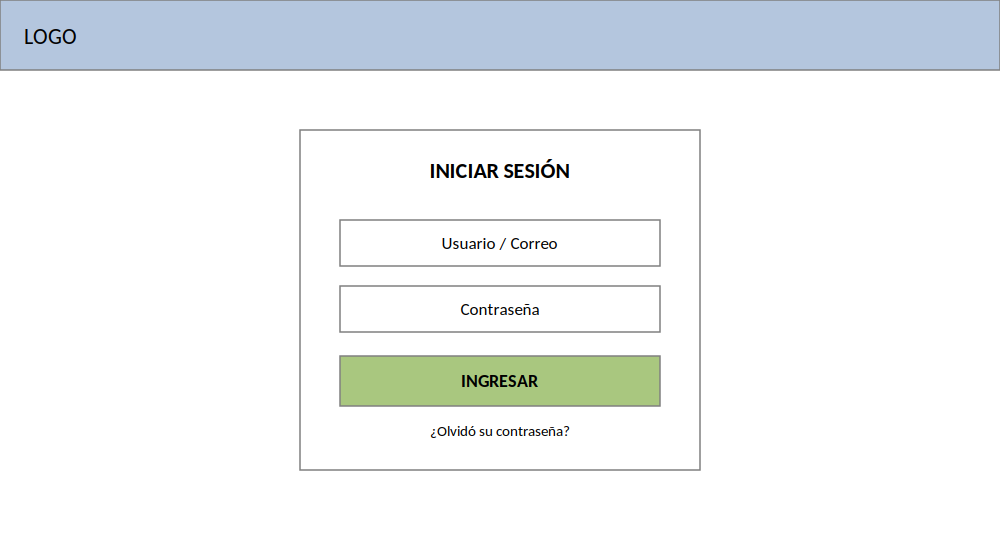</td>
    <td>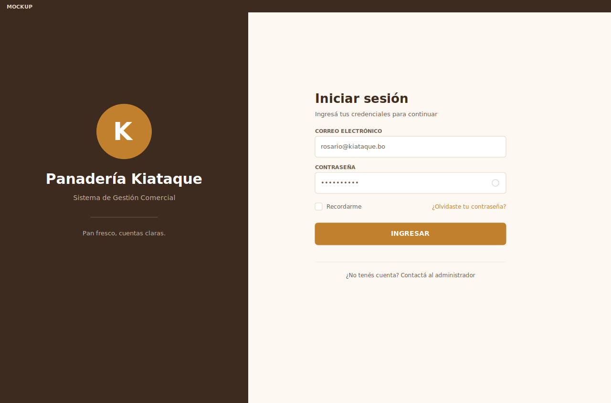</td>
  </tr>
</table>

#### 📊 Pantalla 2 — Panel de Control
Visualización general del estado del negocio con indicadores de ventas, pedidos y stock.

<table>
  <tr>
    <td align="center" width="50%"><b>Wireframe</b></td>
    <td align="center" width="50%"><b>Mockup</b></td>
  </tr>
  <tr>
    <td>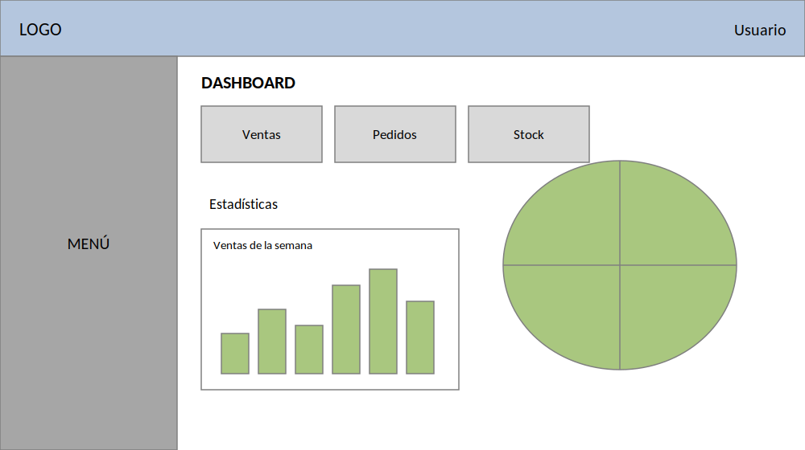</td>
    <td>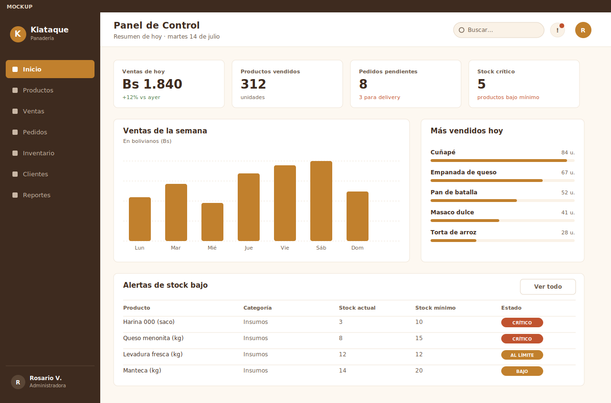</td>
  </tr>
</table>

---

### 👤 Marco Antonio Kiataque Uchiba

#### 📦 Pantalla 3 — Catálogo de Productos
Gestión del catálogo de productos de la panadería.

<table>
  <tr>
    <td align="center" width="50%"><b>Wireframe</b></td>
    <td align="center" width="50%"><b>Mockup</b></td>
  </tr>
  <tr>
    <td>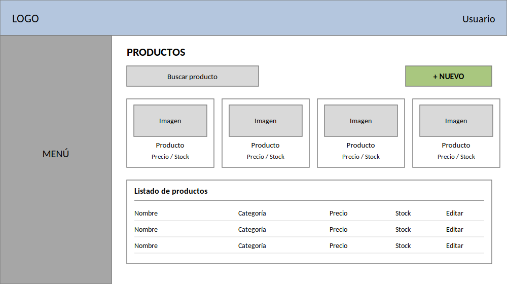</td>
    <td>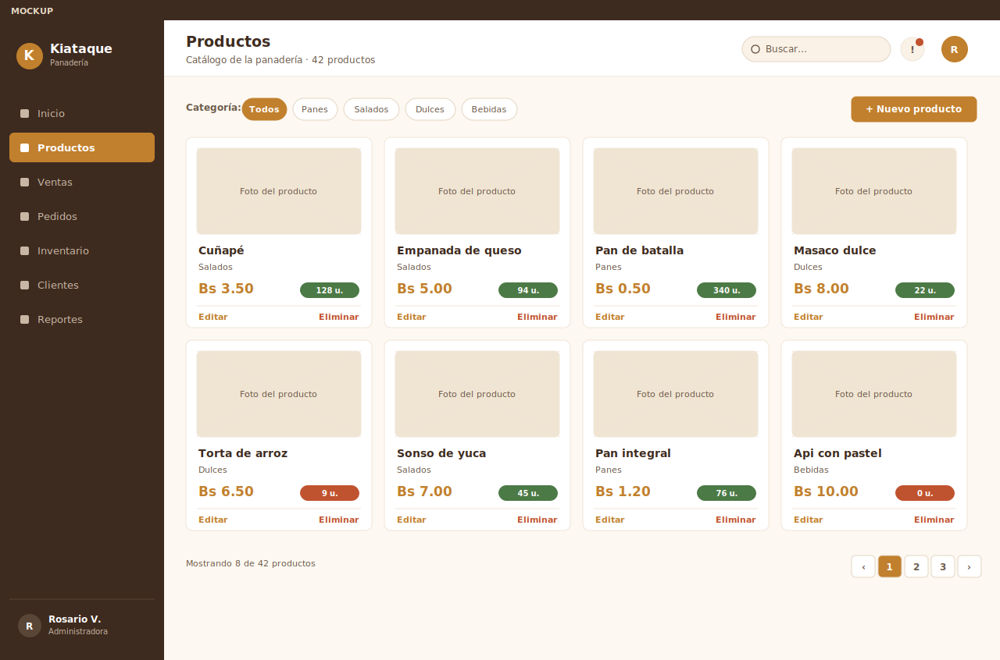</td>
  </tr>
</table>

#### 🛒 Pantalla 4 — Punto de Venta
Registro rápido de ventas en mostrador.

<table>
  <tr>
    <td align="center" width="50%"><b>Wireframe</b></td>
    <td align="center" width="50%"><b>Mockup</b></td>
  </tr>
  <tr>
    <td>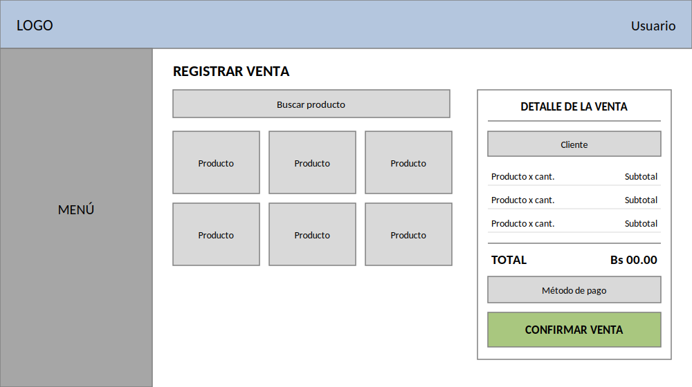</td>
    <td>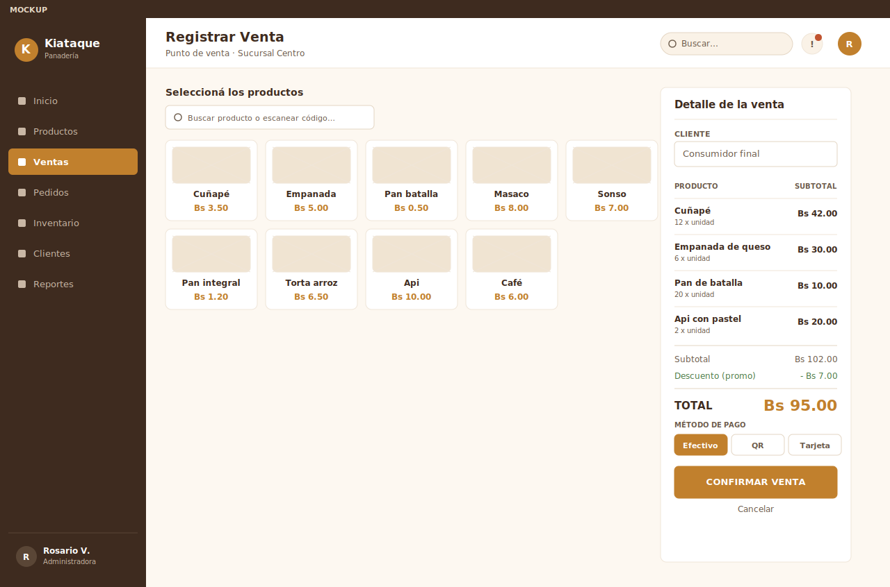</td>
  </tr>
</table>

---

### 👤 Luis Portillo Gonzales

#### 🚚 Pantalla 5 — Pedidos y Delivery
Administración y seguimiento de pedidos realizados por los clientes.

<table>
  <tr>
    <td align="center" width="50%"><b>Wireframe</b></td>
    <td align="center" width="50%"><b>Mockup</b></td>
  </tr>
  <tr>
    <td>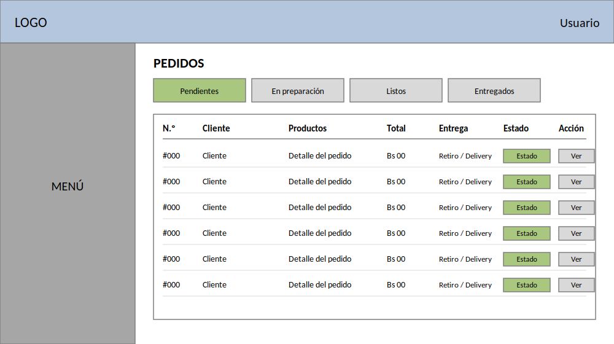</td>
    <td>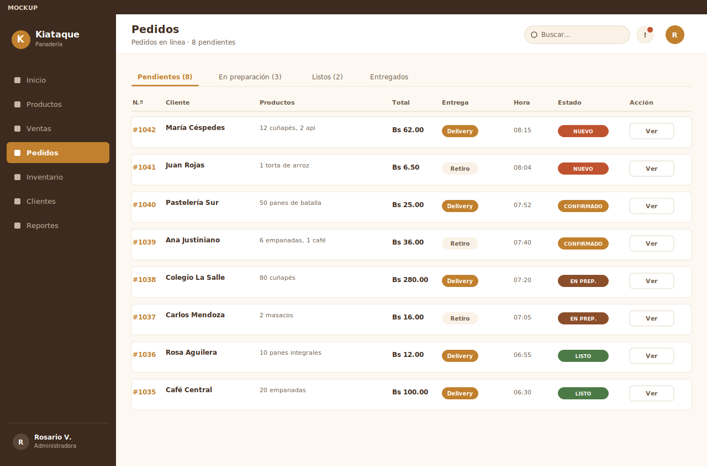</td>
  </tr>
</table>

#### 📋 Pantalla 6 — Inventario
Control del stock de productos terminados e insumos.

<table>
  <tr>
    <td align="center" width="50%"><b>Wireframe</b></td>
    <td align="center" width="50%"><b>Mockup</b></td>
  </tr>
  <tr>
    <td>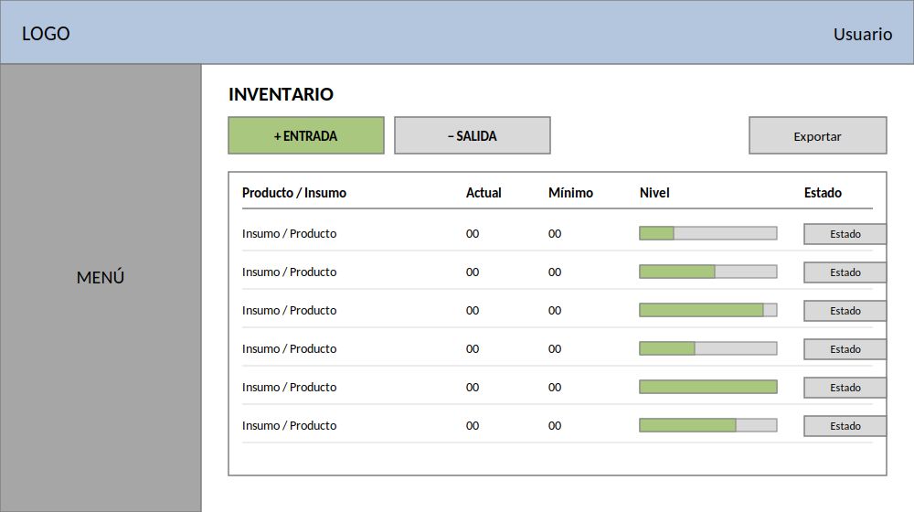</td>
    <td>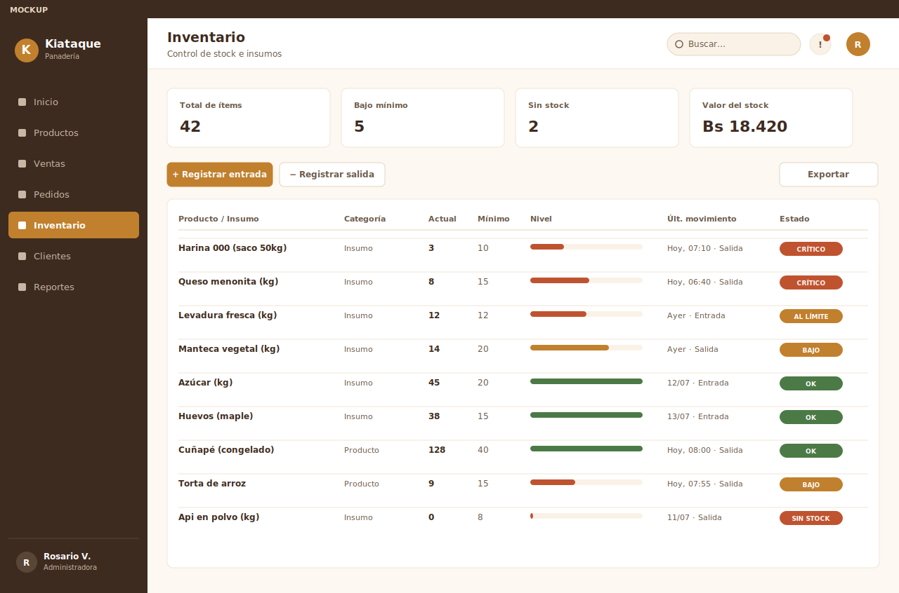</td>
  </tr>
</table>

---

## 🧪 Pruebas de Funcionamiento API Backend (CRUD Productos)

El backend en **.NET 7 Web API** (`BackendApi`) expone operaciones RESTful documentadas mediante **Swagger UI**. A continuación, se presentan las evidencias del ciclo de vida completo (CRUD) probado sobre el controlador de Productos:

### 📸 Evidencias de Operaciones HTTP

<table>
  <tr>
    <td align="center" width="50%"><b>01. POST — Registrar Nuevo Producto</b></td>
    <td align="center" width="50%"><b>02. GET por ID — Consultar Registro Creado</b></td>
  </tr>
  <tr>
    <td></td>
    <td></td>
  </tr>
  <tr>
    <td>Creación exitosa <code>200 OK</code> agregando el producto "pan frances de chocolate" (ID 8).</td>
    <td>Consulta directa <code>200 OK</code> especificando el identificador único (ID 8).</td>
  </tr>
  <tr>
    <td align="center" width="50%"><b>03. PUT — Actualizar Datos de Producto</b></td>
    <td align="center" width="50%"><b>04. DELETE — Eliminar Registro</b></td>
  </tr>
  <tr>
    <td></td>
    <td></td>
  </tr>
  <tr>
    <td>Modificación exitosa <code>200 OK</code> actualizando a "frances con vainilla".</td>
    <td>Eliminación exitosa <code>200 OK</code> confirmando "Producto 8 eliminado correctamente".</td>
  </tr>
</table>

#### 🔍 Verificación de Eliminación (Validación de Error 404)

<table>
  <tr>
    <td align="center" width="100%"><b>05. GET por ID — Confirmación de Registro Inexistente</b></td>
  </tr>
  <tr>
    <td></td>
  </tr>
  <tr>
    <td align="center">Respuesta controlada <code>404 Not Found</code> confirmando que el producto 8 ya no existe en el sistema.</td>
  </tr>
</table>

---

## 🧪 Pruebas de Funcionamiento API Backend (CRUD Pedidos)

El backend en **.NET 7 Web API** (`BackendApi`) expone operaciones RESTful documentadas mediante **Swagger UI**. A continuación, se presentan las evidencias del ciclo de vida completo (CRUD) probado sobre el controlador de Pedidos:

### 📸 Evidencias de Operaciones HTTP

<table>
  <tr>
    <td align="center" width="50%"><b>01. GET — Listar Todos los Pedidos</b></td>
    <td align="center" width="50%"><b>02. POST — Registrar Nuevo Pedido</b></td>
  </tr>
  <tr>
    <td></td>
    <td></td>
  </tr>
  <tr>
    <td>Respuesta exitosa <code>200 OK</code> retornando el listado general en formato JSON.</td>
    <td>Creación exitosa <code>201 Created</code> agregando el pedido ID 5.</td>
  </tr>
  <tr>
    <td align="center" width="50%"><b>03. GET por ID — Consultar Registro Creado</b></td>
    <td align="center" width="50%"><b>04. PUT — Actualizar Datos de Pedido</b></td>
  </tr>
  <tr>
    <td></td>
    <td></td>
  </tr>
  <tr>
    <td>Consulta directa <code>200 OK</code> especificando el identificador único (ID 5).</td>
    <td>Modificación <code>204 No Content</code> actualizando estado y detalle del pedido.</td>
  </tr>
  <tr>
    <td align="center" width="50%"><b>05. GET por ID — Validar Edición</b></td>
    <td align="center" width="50%"><b>06. DELETE — Eliminar Registro</b></td>
  </tr>
  <tr>
    <td></td>
    <td></td>
  </tr>
  <tr>
    <td>Verificación <code>200 OK</code> confirmando los cambios realizados en el payload.</td>
    <td>Eliminación exitosa <code>204 No Content</code> del pedido ID 5.</td>
  </tr>
</table>

#### 🔍 Verificación de Eliminación (Validación de Error 404)

<table>
  <tr>
    <td align="center" width="100%"><b>07. GET por ID — Confirmación de Registro Inexistente</b></td>
  </tr>
  <tr>
    <td></td>
  </tr>
  <tr>
    <td align="center">Respuesta controlada <code>404 Not Found</code> confirmando que el recurso ya no existe en el sistema.</td>
  </tr>
</table>

---

## 🧪 Pruebas de Funcionamiento API Backend (CRUD Proveedores)

El backend en **.NET 7 Web API** (`BackendApi`) expone operaciones RESTful documentadas mediante **Swagger UI**. A continuación, se presentan las evidencias del ciclo de vida completo (CRUD) probado sobre el controlador de Proveedores:

### 📸 Evidencias de Operaciones HTTP

<table>
  <tr>
    <td align="center" width="50%"><b>01. GET — Listar Todos los Proveedores</b></td>
    <td align="center" width="50%"><b>02. POST — Registrar Nuevo Proveedor</b></td>
  </tr>
  <tr>
    <td></td>
    <td></td>
  </tr>
  <tr>
    <td>Respuesta exitosa <code>200 OK</code> retornando el listado general en formato JSON.</td>
    <td>Creación exitosa <code>201 Created</code> agregando al proveedor ID 5.</td>
  </tr>
  <tr>
    <td align="center" width="50%"><b>03. GET por ID — Consultar Registro Creado</b></td>
    <td align="center" width="50%"><b>04. PUT — Actualizar Datos de Proveedor</b></td>
  </tr>
  <tr>
    <td></td>
    <td></td>
  </tr>
  <tr>
    <td>Consulta directa <code>200 OK</code> especificando el identificador único (ID 5).</td>
    <td>Modificación <code>204 No Content</code> actualizando nombre y rubro comercial.</td>
  </tr>
  <tr>
    <td align="center" width="50%"><b>05. GET por ID — Validar Edición</b></td>
    <td align="center" width="50%"><b>06. DELETE — Eliminar Registro</b></td>
  </tr>
  <tr>
    <td></td>
    <td></td>
  </tr>
  <tr>
    <td>Verificación <code>200 OK</code> confirmando los cambios realizados en el payload.</td>
    <td>Eliminación exitosa <code>204 No Content</code> del proveedor ID 5.</td>
  </tr>
</table>

#### 🔍 Verificación de Eliminación (Validación de Error 404)

<table>
  <tr>
    <td align="center" width="100%"><b>07. GET por ID — Confirmación de Registro Inexistente</b></td>
  </tr>
  <tr>
    <td></td>
  </tr>
  <tr>
    <td align="center">Respuesta controlada <code>404 Not Found</code> confirmando que el recurso ya no existe en el sistema.</td>
  </tr>
</table>

---

## ⚙️ Arquitectura del Backend

El backend está desarrollado bajo la plataforma .NET utilizando arquitectura en capas y controladores RESTful:

* **Controladores e Integración:**
  * `ProveedoresController`: Gestión de proveedores (`GET`, `POST`, `PUT`, `DELETE`).
  * `ClientesController`, `PedidosController`, `ProductoController`: Gestión operativa integral.
* **Middleware y Documentación:**
  * **Swagger / OpenAPI** mediante `Swashbuckle.AspNetCore` para consumo dinámico de endpoints.

---

## 🛠️ Herramientas y Configuración Recomendada

Para un correcto desarrollo del proyecto, se sugiere configurar el entorno local con las siguientes herramientas:

### Configuración de IDE Recomendada
* **Editor de código:** [VS Code](https://code.visualstudio.com/)
* **Extensiones:** [Vue (Official)](https://marketplace.visualstudio.com/items?itemName=Vue.volar) (se recomienda desactivar la extensión *Vetur* para evitar conflictos de sintaxis).

### Configuración Recomendada de Navegadores
* **Navegadores basados en Chromium (Chrome, Edge, Brave, etc.):**
  - Instalar [Vue.js devtools](https://chromewebstore.google.com/detail/vuejs-devtools/nhdogjmejiglipccpnnnanhbledajbpd).
  - Activar [Custom Object Formatter en Chrome DevTools](http://bit.ly/object-formatters).
* **Firefox:**
  - Instalar [Vue.js devtools](https://addons.mozilla.org/en-US/firefox/addon/vue-js-devtools/).
  - Activar [Custom Object Formatter en Firefox DevTools](https://fxdx.dev/firefox-devtools-custom-object-formatters/).

---
## 🚀 Guía de Instalación y Configuración

Sigue estos pasos para levantar el entorno de desarrollo localmente:

### 1. Clonar el repositorio
```sh
git clone [https://github.com/tu-usuario/gestion-panaderiakiataque-vue.git](https://github.com/tu-usuario/gestion-panaderiakiataque-vue.git)
cd gestion-panaderiakiataque-vue
```
### 2. Instalar dependencias del proyecto
```sh
npm install
```
### 3. Compilar y arrancar el servidor de desarrollo (Hot-Reload)
```sh
npm run dev
```
### 4. Compilar y minificar para producción
```sh
npm run build
```
### ⚙️ Configuración Adicional
Para más detalles sobre la configuración avanzada de compilación, consulta la Referencia de Configuración de Vite.


---

## ⚙ Ejecución del Proyecto (Backend + Frontend)

Para levantar ambos proyectos en paralelo y habilitar la comunicación entre el Frontend y el Backend, sigue los siguientes pasos:

### 1. Levantar el Backend (.NET 7)

Navega al directorio del API y ejecuta:

```sh
cd BackendApi
dotnet run
```

La API estar� disponible en \https://localhost:7000\ con Swagger UI accesible en \https://localhost:7000/swagger\.

### 2. Levantar el Frontend (Vue.js + Vite)

Desde la ra�z del repositorio, ejecuta:

```sh
cd FrontendVue
npm install
npm run dev
```

El servidor de desarrollo de Vite estar� disponible en \http://localhost:5173\.

### 3. Comunicaci�n entre Frontend y Backend

Con ambos proyectos en ejecuci�n, el frontend consume los endpoints de la API a trav�s de la instancia centralizada de Axios configurada en \src/api/axios.js\, cuya URL base apunta a \https://localhost:7000/api\. La pol�tica de CORS habilitada en \BackendApi/Program.cs\ permite los or�genes \http://localhost:5173\ y \http://localhost:8080\.

### Requisitos previos

- **.NET 7 SDK** o superior
- **Node.js** v22.18.0 o superior
- **npm** (incluido con Node.js)

---

## 📐 Arquitectura de la Solución

El proyecto est� dividido en dos proyectos independientes que se comunican a trav�s de una API RESTful sobre HTTP/HTTPS:

- **BackendApi** (.NET 7 Web API): Expone endpoints REST documentados con Swagger. Acceso a base de datos mediante Entity Framework Core y SQL Server.
- **FrontendVue** (Vue 3 + Vite): Interfaz de usuario que consume los endpoints del backend mediante Axios. El router y los componentes gestionan el estado de la aplicaci�n del lado del cliente.

### Comunicaci�n entre Frontend y Backend

1. **Instancia centralizada de Axios** (FrontendVue/src/api/axios.js): Configura la URL base (https://localhost:7000/api) y los headers Content-Type: application/json. Todos los componentes importan esta instancia para realizar peticiones HTTP, garantizando consistencia en la configuraci�n.
2. **Pol�tica de CORS** (BackendApi/Program.cs): Registra y aplica una pol�tica de CORS que permite los or�genes http://localhost:5173 y http://localhost:8080 (puertos de desarrollo de Vite), con AllowAnyHeader y AllowAnyMethod. La llamada a pp.UseCors() se posiciona antes de pp.UseAuthorization() para que las solicitudes pasen la validaci�n de CORS antes de la autorizaci�n.
3. **Flujo de datos**: El frontend realiza peticiones GET, POST y DELETE a los endpoints /api/[recurso]. El backend procesa las solicitudes, interact�a con la base de datos mediante EF Core, y responde con datos JSON.

## 🔌 Endpoints Disponibles

### Productos

| M�todo | Endpoint | Descripci�n | Cuerpo de peticaci�n |
|:---|:---|:---|:---|
| GET | /api/productos | Listar todos los productos | — |
| POST | /api/productos | Crear un nuevo producto | { nombre, precio, stock, emprendimientoId, categoriaId, proveedorId? } |
| DELETE | /api/productos/{id} | Eliminar un producto por ID | — |

La lista completa de controladores disponibles en el backend incluye: Productos, Pedidos, Proveedores, Clientes, Ventas, Inventarios, Categorias, Ciudades, Empleados, Usuarios, Roles, Permisos, Sucursales, Dashboard, Configuraciones, Notificaciones, Reportes, Resenas, MovimientosInventario, MetodosPago y Promociones.

## 🔧 Soluci�n de Problemas Comunes

### Error de certificados SSL al conectar por HTTPS en desarrollo

Al usar https://localhost:7000 en desarrollo, el navegador o Axios pueden rechazar el certificado SSL autoadministrado por .NET.

**Soluciones:**
- **En el navegador**: Aceptar el certificado exception en la p�gina de advertencia (Chrome: tipo 	hisisunsafe en la p�gina de error).
- **En el proyecto .NET**: Confiar en el certificado de desarrollo con dotnet dev-certs https --trust.
- **Alternativa temporal**: Cambiar la aseURL de Axios a http://localhost:5000/api (HTTP sin SSL) si el certificado es un bloqueo frecuente.

### Error CORS (No-Access-Control-Allow-Origin)

Si el navegador bloquea las peticiones del frontend al backend con un error CORS:
- Verificar que pp.UseCors(corsPolicyName) est� posicionado antes de pp.UseAuthorization() en Program.cs.
- Confirmar que el puerto del frontend (5173 u 8080) est� incluido en WithOrigins().

### Error despu�s de clonar el repositorio (npm install da errores)

- Ejecutar 
pm install dentro de FrontendVue/ para instalar todas las dependencias.
- Si el problema persiste, eliminar 
ode_modules y package-lock.json y ejecutar 
pm install nuevamente.
- Asegurarse de tener Node.js v22.18.0 o superior instalado.

### El frontend no puede conectar con el backend

- Verificar que ambos proyectos est�n en ejecuci�n simult�neamente.
- Confirmar que la aseURL en xios.js coincide con el puerto en el que escucha la API (https://localhost:7000/api).
- Abrir Swagger (https://localhost:7000/swagger) para probar los endpoints directamente y descartar errores del backend.

### Error 500 en POST /api/productos: OUTPUT clause con triggers SQL Server

Si al registrar un producto desde el formulario el backend devuelve Error 500 y en la consola aparece:
```
The target table 'Producto' of the DML statement cannot have any enabled triggers if the statement contains an OUTPUT clause without INTO clause
```

**Causa:** EF Core usa una cl�usula OUTPUT INSERTED.[Id] en las inserciones para obtener el identificador generado autom�ticamente. SQL Server proh�be esta cl�usula cuando la tabla destino tiene un trigger habilitado.

**Soluci�n aplicada:**
- El ProductosController.Post ahora usa SQL en bruto (ExecuteSqlInterpolatedAsync) en lugar del DbContext.ChangeTracker, generando un INSERT sin cl�usula OUTPUT.
- Despu�s de la inserci�n, se ejecuta SELECT CAST(SCOPE_IDENTITY() AS int) por conexi�n RAW para obtener el nuevo Id generado sin usar OUTPUT.
- EmprendimientoId y CategoriaId son ahora opcionales (int?) en el modelo para permitir registros sin FK previa.
